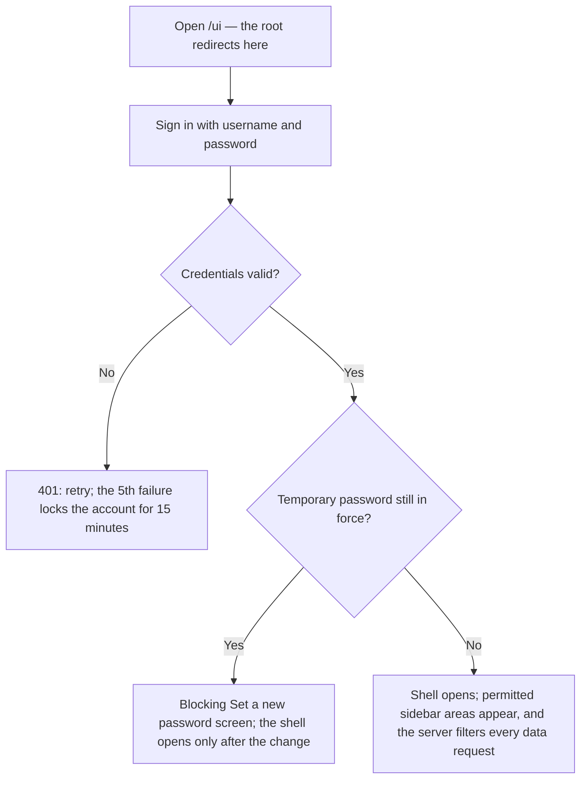
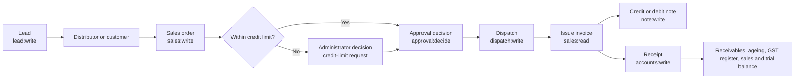
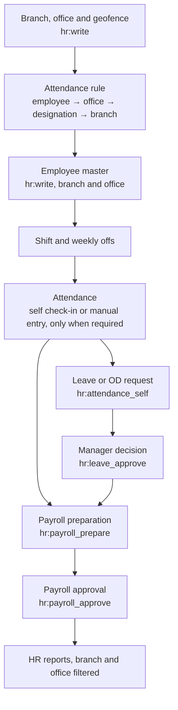

# Herbanova Business Control — User Manual

**Project:** Herbanova Business Control
**Document:** user-manual index; chapters 1, 19 and 20 written
**Stage:** 3 — audit deliverables
**Date:** 31 October 2026; cross-references refreshed 1 November 2026

This folder is the operating manual for the application at `/ui`. It is written for the people who use the system — sales desk, stores, accounts, HR, payroll and administrators — not for developers. Developer-level evidence lives in the Stage 3 registers linked from each chapter.

**Current contents**

| File | Contents |
|---|---|
| [`README.md`](README.md) | This index: scope, reading paths, chapter plan, end-to-end journeys, known gaps |
| [`00-quick-start.md`](00-quick-start.md) | Chapter 1, written in full: signing in, temporary passwords, sessions, lockout, navigation, error messages |
| [`19-hr-people-attendance.md`](19-hr-people-attendance.md) | Chapter 19, written in full: HR dashboard, employee master, branches, offices and attendance policy, shifts, attendance, monthly register, import, profile outputs, letter templates |
| [`20-hr-leave-payroll-reports.md`](20-hr-leave-payroll-reports.md) | Chapter 20, written in full: leave and balances, on-duty, approvals, payroll, period locks, HR reports, announcements, notifications, the HR Report Pack |

The remaining chapters are **planned, not yet written**. Each row below states what the chapter will cover, who it is for, the permissions involved, and the source that will be used to write it, so the manual can be completed without re-auditing the system.

## Evidence conventions

The manual marks every statement about current behaviour:

| Marker | Meaning |
|---|---|
| **VERIFIED** | Read in source and exercised by an automated test or a read-only live check. |
| **VERIFIED (code)** | Read in source; not exercised end-to-end. |
| **PARTIAL** | Works, with a stated limitation. |
| **MISSING** | The server supports it but the browser offers no control — a known gap. |
| **PLANNED** | The chapter is not written yet. |

Cross-references:

- Field-by-field UI/API mapping, including mismatches M-01–M-11: [`../FRONTEND_BACKEND_FIELD_MAPPING.md`](../FRONTEND_BACKEND_FIELD_MAPPING.md)
- Business rules and formulas F-01–F-79: [`../FORMULA_AND_BUSINESS_RULE_REGISTER.md`](../FORMULA_AND_BUSINESS_RULE_REGISTER.md)
- Tables, columns, keys and indexes: [`../DATABASE_TABLE_COLUMN_REGISTER.md`](../DATABASE_TABLE_COLUMN_REGISTER.md)
- Reconciliation evidence: [`../FORMULA_RECONCILIATION_TESTS.md`](../FORMULA_RECONCILIATION_TESTS.md)
- Who may do what: [`../permissions-matrix.md`](../permissions-matrix.md)
- Feature inventory: [`../FEATURE_INVENTORY.md`](../FEATURE_INVENTORY.md)
- Requirements and their evidence: [`../REQUIREMENTS_TRACEABILITY_MATRIX.md`](../REQUIREMENTS_TRACEABILITY_MATRIX.md)
- HR features in detail: [`../HR_FEATURES.md`](../HR_FEATURES.md)
- HR roles and confidentiality: [`../HR_ROLES.md`](../HR_ROLES.md)
- Executed verification evidence: [`../VERIFICATION_REPORT.md`](../VERIFICATION_REPORT.md)

**Limitations of this manual.** No screenshots are stored in the repository. Layout descriptions are based on `static/index.html` and `static/js/app.js`; labels quoted here are the literal on-screen labels. Where the UI lacks a control the server already implements, the chapter says so and points to the mismatch register rather than describing a screen that does not exist.

## Reading paths by role

| You are | Read, in order | You will be able to |
|---|---|---|
| Sales desk (`sales`) | 1, 2, 4, 5, 6, 11, 12, 13, 14, 15, 18 | Work leads, raise sales orders within limits, record challan/e-way, issue notes, print, read receivables |
| Stores / dispatch (`inventory`) | 1, 2, 7, 8, 9, 11, 13, 15 | Maintain products and stock, receive goods, dispatch approved orders, record invoice movement |
| Accounts (`accounts:write`) | 1, 2, 11, 13, 14, 16, 17, 18, 24 | Record receipts and payments, read ledgers, GST register and trial balance, open the Accounts dashboard and report pack |
| HR manager (`hr_manager`) | 1, 2, 19, 20, 21 | Maintain people and shifts, manage attendance, decide leave and OD, read confidential HR reports |
| Payroll officer (`payroll_officer`) | 1, 2, 20 | Prepare payroll and read confidential salary data; approval stays with the Administrator |
| Administrator (`admin`) | all chapters, especially 12, 21, 22, 23, 24 | Own approvals, users and roles, audit, company profile, tax masters, scheduled e-mail and database tools |
| Self-service employee (`employee` / `viewer`) | 1, 2, 19, 20 | Record own attendance and raise own leave/OD requests; see only your own HR approvals |

## Chapter plan

The 24 chapters follow the sidebar and the four end-to-end journeys. Status is the state of the chapter **text**, not of the feature: chapters 1, 19 and 20 are written; the rest are planned. Every feature described in a written chapter is implemented and verified, and the executed evidence is in [`../VERIFICATION_REPORT.md`](../VERIFICATION_REPORT.md).

| # | Chapter | Audience | Permissions / views | Status | Evidence source |
|---|---|---|---|---|---|
| 1 | Getting started | All | Sign-in only | **Written** — [`00-quick-start.md`](00-quick-start.md) | `app/api/auth.py`; `app/services/lockout.py`; `app.js:109-126` |
| 2 | Finding your way: navigation, roles and permissions | All | Menu filtered by permission | **PLANNED** | `app.js:86-103`; `docs/permissions-matrix.md` |
| 3 | Overview dashboard | All | `require_login`; panels vary | **PLANNED** | `app/api/dashboard.py`; `app.js:361-423` |
| 4 | Leads, follow-ups and lost leads | Sales | `lead:read`, `lead:write`, `lead:assign` | **PLANNED** | `app/api/leads.py`; mapping §3 |
| 5 | Customers and distributors (one master) | Sales, accounts | `sales:read`; `distributor:write`, `sales:write`, `credit:manage` to act | **PLANNED** | `app/api/distributors.py`; `#/customers` in `app.js`; mapping §4 |
| 6 | Credit limits and exposure | Sales, admin | `credit:manage`; second-person approval | **PLANNED** | `app/api/distributors.py`; formula register F-20 |
| 7 | Products and GST rates | Stores, sales | `product:read/write`, `tax:read` | **PLANNED** | `app/api/products.py`; `app/api/tax.py`; mapping §5 |
| 8 | Inventory and warehouses | Stores | `stock:read`, `stock:write` | **PLANNED** | `app/api/inventory.py`; mapping §6; FEFO rules F-24–F-30 |
| 9 | Purchases and goods receipts | Stores, admin | `stock:read/write`, `supplier:read` | **PLANNED** | `app/api/purchase_orders.py`; mapping §7 |
| 10 | Suppliers and bank-detail changes | Admin, stores | `supplier:read/write/bank`; second-person approval | **PLANNED** | `app/api/suppliers.py`; mapping §8 |
| 11 | Sales orders | Sales, admin | `sales:read/write`, `approval:decide` | **PLANNED** | `app/api/sales_orders.py`; F-20; mapping §9 |
| 12 | Approvals and segregation of duties | Admin, approvers | `approval:read`, `approval:decide`; role check for credit-limit and post-billing | **PLANNED** | `app/api/approvals.py:147-224`; permissions matrix |
| 13 | Billing and invoices | Sales, stores | `sales:read`, `invoice:write/cancel` | **PLANNED** | `app/api/invoices.py`; mapping §10; immutability rules F-37–F-43 |
| 14 | Credit and debit notes | Sales, admin | `note:write` | **PLANNED** | `app/api/notes.py`; F-45–F-46; caps recorded as PARTIAL in the formula register |
| 15 | Printing secure documents | Sales, stores, admin | `print:document` | **PLANNED** | `app/api/printing.py`; `app/services/document_pdf.py`; invoice/CN/DN only — no PO print |
| 16 | Accounts, outstanding and party ledgers | Accounts | `accounts:read/write` | **PLANNED** | `app/api/accounts.py`; mapping §11; M-02 on unallocated receipts |
| 17 | GST register and trial balance | Accounts, admin | `accounts:read` | **PLANNED** | `app/api/accounts.py`; mapping §12 |
| 18 | Reports and exports | Sales, accounts, HR | Per-report view permission; `report:export` to download | **PLANNED** | `app/api/reports.py`; `app/services/reports.py`; reconciliation record |
| 19 | HR: people, shifts and attendance | HR, staff | `hr:read/write`, `hr:attendance_self`, `hr:attendance_manage` | **Written** — [`19-hr-people-attendance.md`](19-hr-people-attendance.md) | [`../HR_FEATURES.md`](../HR_FEATURES.md); `app/api/hr.py`; `tests/test_hr_directory.py`, `test_hr_attendance.py`, `test_hr_sites.py` |
| 20 | HR: leave, on-duty, payroll and HR reports | HR, payroll, staff | `hr:leave_approve`, `hr:payroll_prepare/approve`, `hr:confidential`, `hr:reports` | **Written** — [`20-hr-leave-payroll-reports.md`](20-hr-leave-payroll-reports.md) | [`../HR_FEATURES.md`](../HR_FEATURES.md); `tests/test_hr_leave.py`, `tests/test_hr_payroll_outputs.py`, `tests/test_hr_reports.py` |
| 21 | Users, roles and the audit trail | Admin | `user:manage`, `employee:read/write`, `audit:read` | **PLANNED** | `app/api/users.py`; `app/api/employees.py`; `app/api/audit.py`; mapping §15–16 |
| 22 | Settings, company profile and database tools | Admin | `tax:read/write`, `user:manage`, `db:reset` + secondary password | **PLANNED** | `app/api/company.py`, `app/api/admin.py`, `app/api/db_reset.py`; `backup_restore_test.py` |
| 23 | Scheduled e-mail reports | Admin | `email:manage` | **Not written — feature VERIFIED (test mode)** | [`../EMAIL_REPORTS.md`](../EMAIL_REPORTS.md); `tests/test_email_reports.py`, `test_email_schedules.py`, `test_email_api.py` |
| 24 | Accounts dashboard, comparison and report pack | Accounts, admin | `accounts:reports` (plus `accounts:read`) | **Not written — feature VERIFIED** | [`../DASHBOARD_FEATURES.md`](../DASHBOARD_FEATURES.md) §14–15; `tests/test_accounts_reports.py` |

**Appendices**

| Appendix | Contents | Status |
|---|---|---|
| A | Error messages, HTTP status codes and what to do | Partly in chapter 1; extended when other chapters are written |
| B | Glossary (issued invoice, challan, e-way bill, FEFO, OD, credit exposure, round-off) | **PLANNED** |
| C | Known limitations that affect daily use (M-01–M-11, payroll skipping, in-memory paging) | **PLANNED** — summarised below |
| D | Evidence ledger: which chapters were verified against code, tests or live counts | **PLANNED** |

## End-to-end journeys

### Signing in

### Sales to cash

Post-billing amendments are a separate branch: the sales desk **requests** the change; only an Administrator **other than the requester** can decide it (`app/api/approvals.py:194-203`).

### HR request to payroll

Staff without `hr:read` see the HR home page and their **own** attendance only; the directory, leave/OD registers and payroll actions are hidden and refused by the server (`app.js:602-610`).

**Branch and office scope.** `hr:write` creates branches and offices (with an optional geofence centre and radius) and writes the attendance rules that decide who must mark attendance. The most specific rule wins — employee, then office, then designation, then branch — and with no rule attendance is required. An exempt employee is refused a check-in, check-out, correction, manual entry or bulk row by the server with the rule named, so the screen's hidden controls are a convenience, not the control. Every list, the monthly register and the reports accept `branch_id` and `office_id`; a printed sheet repeats the filter it used.

## Known gaps that shape the instructions

These are verified limitations, not instructions to work around them silently. Each must be read before writing the affected chapter.

| Gap | Effect on the manual | Source |
|---|---|---|
| **M-02** "Not allocated yet" rejected | The accounts chapter must require an invoice or purchase order for every receipt/payment, despite the empty option in the drawer | `app/api/accounts.py:124-160` |
| **M-06** No salary-component or salary-structure screen; payroll skips employees without a structure | The payroll chapter must start with a warning about the silent skip. Branches, offices and attendance rules now have a screen; departments, holidays, leave types and the salary masters still do not | `app/services/payroll.py:59-60`; mapping §14.6 |
| **M-09** Manual attendance cannot record punch times or office | The attendance chapter must say corrections are status-only from the screen | mapping §14 |
| **In-memory report paging** | A very large register is fully built before the page is sliced; the reports chapter must warn about long-running exports | `app/api/reports.py:118-132` |
| **17 row-count-only registers** | The reports chapter must not promise independent reconciliation for those reports | `docs/FORMULA_RECONCILIATION_TESTS.md` |

## Maintaining this manual

1. Change a workflow in `app/api/` or `static/js/app.js` → update the matching chapter and the field mapping in the same change.
2. Change a permission key → regenerate `docs/permissions-matrix.md` and update the chapter's audience row.
3. Close a mismatch (M-01–M-11) → remove the gap from the chapter and from the matrix of known gaps.
4. Never include live credentials, customer names, salary figures or production data in the manual. Examples must be synthetic.
